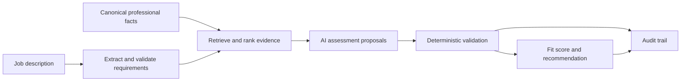

# Career Copilot

> Evidence-based career and job-opportunity decision support, combining structured data, AI assistance and deterministic rules.

Career Copilot is a personal software project for organising professional information and assessing job opportunities against traceable evidence.

The wider product vision covers the application lifecycle. The implemented core focuses on **professional profiles, job-description intake, requirement assessment and auditable fit scoring**.

## Development status

**Status as of 29 October 2026: backend prototype under active validation.**

The public `main` branch and the latest local development version are currently different:

| Area | Published backend | Latest local development — not yet published |
|---|---|---|
| Professional profile | Structured profile import, canonical sources and fact provenance | Versioned reconciliation of profile updates with preserved history |
| Job descriptions | Opportunity storage, deterministic and OpenAI extraction, verbatim source validation | Broader responsibility extraction and a source-bullet coverage inventory |
| Evidence | Governed retrieval, lexical ranking and data minimisation | Multilingual relevance expansion and protection against primary evidence being displaced |
| Assessment | OpenAI semantic proposals checked against deterministic rules | Immediate validation, one corrective retry and an audit of rejected attempts |
| Fit results | Deterministic scoring and uncertainty handling | Professional score separated from practical conditions, with coverage and provisional status |
| Review workflow | Business services callable from Python | Local CLI for extraction, explicit requirement review and evaluation |
| Tests | Unit and PostgreSQL integration tests | 212 tests passing with synthetic data in an automatically isolated PostgreSQL schema |

The local test result was verified on **28 October 2026**. It applies to the unpublished development version, not to a fresh checkout of the public branch.

There is **no product web interface or complete application tracker yet**. The public FastAPI entry point currently exposes a health check; business workflows are implemented as Python services.

## What the backend does

The central workflow is:



The backend provides:

- **Profile import:** structured facts about experience, education, skills and career objectives, linked to their source.
- **Job-description intake:** stored opportunities and requirements, with evidence excerpts grounded in the original description.
- **Evidence selection:** retrieval and ranking of eligible, confirmed profile facts for each requirement.
- **Semantic assessment:** AI-assisted proposals of `MATCH`, `PARTIAL_MATCH`, `GAP` or `UNKNOWN`.
- **Deterministic scoring:** explicit weights, blocking rules and uncertainty rules, separate from the language model.
- **Auditability:** recorded inputs, outputs, rule versions and provider telemetry.

OpenAI integration is implemented for extraction and semantic assessment. The model proposes an interpretation; it does not determine the numerical score.

## Interpreting a result

A score is useful only alongside its **evidence coverage and unresolved requirements**.

- Missing evidence is `UNKNOWN`; it does not establish a gap.
- A confirmed gap needs affirmative evidence of contradiction or non-compliance.
- Unknown requirements are excluded from the numerical score denominator, so a high score can coexist with incomplete evidence.
- Lexical similarity is a retrieval signal, not proof of professional competence.
- Recommendations support human review; they do not submit applications or make career decisions.

The local development version also reports salary, residence, vehicle ownership and work arrangements separately from professional fit.

## Governance and privacy

The project follows these principles:

- Structured data before prompting.
- Deterministic business rules separated from AI reasoning.
- No invented professional facts.
- Traceability to source evidence.
- Human review of consequential decisions.
- No autonomous external actions.
- Minimal, explicitly selected evidence sent to external model providers.

This public repository does **not** contain the author's real career profile, applications, credentials or private evaluation reports. Example and synthetic data illustrate the expected structures.

Environment files and private `*.local.json` data are excluded from version control.

## Architecture and stack

The application is a **modular monolith**, organised into profile, opportunities, fit, governance and audit modules.

- Python **3.14+**
- FastAPI and Pydantic
- SQLAlchemy and PostgreSQL
- Alembic migrations
- OpenAI SDK
- YAML-based rule configuration
- Docker Compose
- Pytest and Ruff

```text
app/
├── domain/                 # Enums and rule policies
├── infrastructure/db/      # Database setup
└── modules/
    ├── profile/
    ├── opportunities/
    ├── fit/
    ├── governance/
    └── audit/
migrations/
rules/
seeds/career_master/
tests/
```

## Running the published snapshot locally

### 1. Install

```bash
git clone https://github.com/paumr90/career-copilot.git
cd career-copilot
python -m venv .venv
```

Activate the virtual environment, then install the project and development dependencies:

```bash
python -m pip install -e ".[dev]"
```

### 2. Configure

Copy `.env.example` to `.env` and set the local database configuration.

For real model calls, configure `LLM_PROVIDER`, `LLM_API_KEY` and `LLM_MODEL` locally. Use a model available to your API account. Do not commit credentials.

### 3. Start PostgreSQL and migrate

```bash
docker compose up -d
alembic upgrade head
```

### 4. Run the health endpoint

```bash
uvicorn app.main:app --reload
```

The health check is available at `/health`.

### 5. Run tests

```bash
pytest tests/unit
```

The public snapshot's integration tests require a migrated, seeded PostgreSQL database. Some tests depend on assumptions about the original profile dataset; the public example seed is not a complete replacement for that dataset.

The unpublished local suite removes that dependency by creating a temporary schema, running migrations and loading synthetic fixtures. Its CLI and isolated test setup will be documented as runnable public features when their code is published.

## Known limitations

Validation has identified several areas that need further work:

- Evidence selection can omit relevant facts.
- Extracted lists can miss responsibilities, combine distinct capabilities or duplicate related criteria.
- Source-bullet coverage does not prove semantic completeness.
- AI assessments can overstate transferable experience, particularly for architecture and specialised responsibilities.
- Practical conditions need explicit facts: a location preference does not prove residence, and an overlapping salary band is not a confirmed offer.

Passing software tests does not establish assessment quality. Real job descriptions are being compared against manually reviewed reference assessments.

## Next milestones

1. Compare the current workflow across several contrasting job opportunities.
2. Resolve recurring extraction, evidence-selection and assessment discrepancies.
3. Publish the validated local workflow and self-contained test setup.
4. Build a minimal interface for requirement review and evidence inspection.
5. Add application stages, interviews, follow-ups and archival.
6. Explore CV support and controlled external integrations.

The MVP is intentionally kept small and modular so each capability can be tested and reviewed before the product expands.

## License

Copyright © 2026 Pau Modolell. All rights reserved.

This repository is shared publicly for portfolio and educational purposes.
No permission is granted to reproduce, distribute or create derivative works
from the source code without prior written permission.

---

Built by [Pau Modolell](https://github.com/paumr90)
