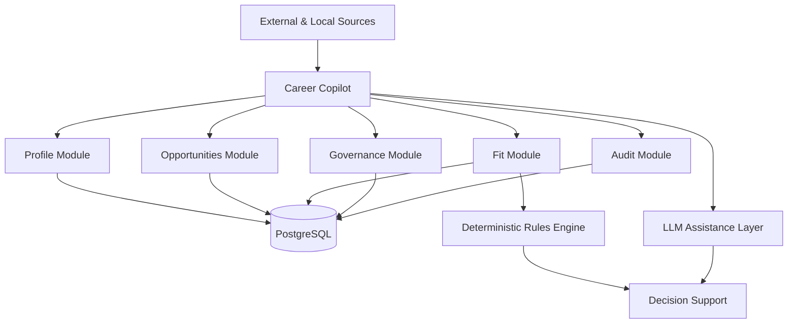

# Career Copilot

> An AI-assisted career management and job application decision-support system.

Career Copilot is a personal project designed to structure professional information, evaluate job opportunities and support the end-to-end job application lifecycle.

The project explores how **AI, structured data and deterministic business rules** can work together to provide useful decision support without losing traceability, governance or human control.

## Why this project?

Job searching involves information scattered across CVs, job descriptions, emails, application portals and personal notes.

Career Copilot aims to turn that fragmented information into a structured system capable of supporting decisions such as:

- Is this opportunity worth pursuing?
- How well does it match the professional profile?
- Which requirements are strong matches or gaps?
- How should the candidate position their experience?
- What is the current status of each application?
- What patterns can be learned across multiple selection processes?

The objective is not to automate career decisions, but to build a **human-in-the-loop decision-support system**.

## Core design principles

The MVP follows a set of explicit governance principles:

- **Structured data before prompting**
- **Deterministic rules separated from LLM reasoning**
- **No invented professional facts**
- **Traceability of important data to its source**
- **Human approval for consequential actions**
- **No autonomous external actions**
- **Personal and sensitive information remains private**
- **Small, modular and testable MVP architecture**

## Current scope

Career Copilot is being developed incrementally around the following functional areas:

### Professional profile

Structured representation of experience, education, skills and career objectives.

### Opportunities

Storage and analysis of job opportunities and their requirements.

### Fit assessment

Evaluation of the match between a professional profile and a job opportunity using explicit rules and evidence.

### Governance

Rules controlling how information is interpreted, modified and used by the system.

### Auditability

Traceability of relevant facts, decisions and changes.

### AI layer

LLM capabilities are designed as an assistance layer rather than the source of truth. Structured data and deterministic rules remain separate from generated reasoning.

## Architecture

The MVP uses a **modular monolith** architecture.



The architecture intentionally keeps deterministic business logic independent from the LLM layer.

## Technology stack

- **Python**
- **PostgreSQL**
- **Docker / Docker Compose**
- **Alembic**
- **Pytest**
- **LLM integration**
- **Git / GitHub**

## Project structure

```text
career-copilot/
│
├── app/
│   ├── domain/
│   ├── infrastructure/
│   └── modules/
│       ├── audit/
│       ├── fit/
│       ├── governance/
│       ├── opportunities/
│       └── profile/
│
├── migrations/
├── rules/
├── seeds/
├── tests/
│
├── .env.example
├── alembic.ini
├── docker-compose.yml
├── pyproject.toml
└── README.md
```

## Data and privacy

This public repository does **not** contain my real career profile, applications, credentials or personal datasets.

Example files are included where useful to illustrate the expected data structures.

Local data files, environment variables, credentials and other private information are explicitly excluded from version control.

## Local development

### 1. Clone the repository

```bash
git clone https://github.com/paumr90/career-copilot.git
cd career-copilot
```

### 2. Create the environment configuration

Copy:

```text
.env.example
```

to:

```text
.env
```

and configure the required local values.

### 3. Start PostgreSQL

```bash
docker compose up -d
```

### 4. Install the project

Create and activate a Python virtual environment and install the project dependencies defined in `pyproject.toml`.

### 5. Run database migrations

```bash
alembic upgrade head
```

### 6. Run tests

```bash
pytest
```

## Development approach

The project is intentionally being built as a **small functional MVP rather than a large agent architecture**.

New capabilities are added only when they provide clear user value or are required for correctness, security or maintainability.

This keeps the system understandable, testable and easy to evolve.

## Roadmap

Planned areas of development include:

- richer opportunity ingestion;
- requirement extraction;
- evidence-based fit scoring;
- application pipeline tracking;
- CV and positioning support;
- interview preparation;
- feedback analysis;
- controlled external integrations;
- improved AI-assisted decision support.

## Context

Career Copilot is a personal project exploring the practical application of
**AI, data modelling, governance and software architecture** to a real-world
professional workflow.

It also serves as a hands-on environment for translating business requirements
into a working technical product.

## License

Copyright © 2026 Pau Modolell. All rights reserved.

This repository is shared publicly for portfolio and educational purposes.
No permission is granted to reproduce, distribute or create derivative works
from the source code without prior written permission.

---

Built by [Pau Modolell](https://github.com/paumr90)