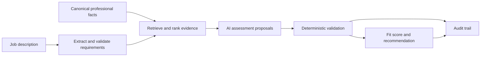

# Career Copilot

> Evidence-based career and job-opportunity decision support, combining structured data, AI assistance and deterministic rules.

Career Copilot is a personal software project for organising professional information and assessing job opportunities against traceable evidence.

The wider product vision covers the application lifecycle. The implemented core focuses on **professional profiles, job-description intake, requirement assessment and auditable fit scoring**.

## Development status

**Status as of 29 October 2026: backend prototype under active validation.**

This checkout includes the reviewed CLI workflow and isolated test setup:

| Area | Implemented capability |
|---|---|
| Professional profile | Structured facts, canonical sources and versioned provenance |
| Job descriptions | Governed extraction, verbatim validation, one corrective attempt and source-bullet inventory |
| Evidence | Governed retrieval, multilingual ranking and minimal evidence projection |
| Assessment | Semantic proposals, deterministic admissibility checks and rejected-attempt audits |
| Results | Coverage and critical unknowns first; professional scores separate from practical conditions |
| Review workflow | CLI for extraction, explicit requirement review and evaluation; rollback by default |
| Tests | 224 passing unit and PostgreSQL integration tests using synthetic data |

The suite was verified locally on **29 October 2026**. This is a software-test result, not a measured assessment-accuracy claim. An opt-in live diagnostic matched 9 of 10 synthetic reference labels; the remaining partner/vendor ambiguity is documented in [validation notes](docs/semantic-validation.md).

There is **no product web interface or complete application tracker yet**. The public FastAPI entry point currently exposes a health check; business workflows are implemented as Python services.

## What the backend does

The central workflow is:



The backend provides:

- **Profile import:** structured facts about experience, education, skills and career objectives, linked to their source.
- **Job-description intake:** stored opportunities and requirements, with evidence excerpts grounded in the original description.
- **Evidence selection:** retrieval and ranking of eligible, confirmed profile facts for each requirement.
- **Semantic assessment:** AI-assisted proposals of `MATCH`, `PARTIAL_MATCH`, `GAP` or `UNKNOWN`.
- **Deterministic scoring:** explicit weights, blocking rules and uncertainty rules, separate from the language model.
- **Auditability:** recorded inputs, outputs, rule versions and provider telemetry.

OpenAI integration is implemented for extraction and semantic assessment. The model proposes an interpretation; it does not determine the numerical score.

## Interpreting a result

A score is useful only alongside its **evidence coverage and unresolved requirements**.

- Missing evidence is `UNKNOWN`; it does not establish a gap.
- A confirmed gap needs affirmative evidence of contradiction or non-compliance.
- Unknown requirements are excluded from the numerical score denominator, so a high score can coexist with incomplete evidence.
- Lexical similarity is a retrieval signal, not proof of professional competence.
- Recommendations support human review; they do not submit applications or make career decisions.

The report also presents salary, residence, vehicle ownership and work arrangements separately from professional fit.

## Governance and privacy

The project follows these principles:

- Structured data before prompting.
- Deterministic business rules separated from AI reasoning.
- No invented professional facts.
- Traceability to source evidence.
- Human review of consequential decisions.
- No autonomous external actions.
- Minimal, explicitly selected evidence sent to external model providers.

This public repository does **not** contain the author's real career profile, applications, credentials or private evaluation reports. Example and synthetic data illustrate the expected structures.

Environment files and private `*.local.json` data are excluded from version control.

## Architecture and stack

The application is a **modular monolith**, organised into profile, opportunities, fit, governance and audit modules.

- Python **3.14+**
- FastAPI and Pydantic
- SQLAlchemy and PostgreSQL
- Alembic migrations
- OpenAI SDK
- YAML-based rule configuration
- Docker Compose
- Pytest and Ruff

```text
app/
|-- domain/                 # Enums and rule policies
|-- infrastructure/db/      # Database setup
`-- modules/
    |-- profile/
    |-- opportunities/
    |-- fit/
    |-- governance/
    `-- audit/
migrations/
rules/
seeds/career_master/
tests/
```

## Running locally

### 1. Install

```bash
git clone https://github.com/paumr90/career-copilot.git
cd career-copilot
python -m venv .venv
```

Activate the virtual environment, then install the project and development dependencies:

```bash
python -m pip install -e ".[dev]"
```

### 2. Configure

Copy `.env.example` to `.env` and set the local database configuration.

For real model calls, configure `LLM_PROVIDER`, `LLM_API_KEY` and `LLM_MODEL` locally. Use a model available to your API account. Do not commit credentials.

### 3. Start PostgreSQL and migrate

```bash
docker compose up -d
alembic upgrade head
```

### 4. Run the health endpoint

```bash
uvicorn app.main:app --reload
```

The health check is available at `/health`.

### 5. Run tests

```bash
pytest tests/unit
```

For the full suite, run `pytest` with a reachable PostgreSQL database. Tests create a temporary schema, apply migrations, load synthetic fixtures and drop the schema afterward. The database user needs schema-creation permission; set `TEST_DATABASE_URL` for a dedicated test database. Unit-only runs do not use PostgreSQL.

### 6. Review and evaluate an opportunity

```bash
python -m app.cli extract --input work/raw-job.local.json --output work/job.local.json
python -m app.cli review-template --input work/job.local.json --output work/review.local.json
# Review every requirement, fill reviewer/reviewed_keys and record any amendments.
python -m app.cli review --input work/review.local.json --output work/approved.local.json
python -m app.cli evaluate --review work/approved.local.json --output work/result.local.json
```

Evaluation requires a canonical profile already imported into the database. Do not substitute the author's private data. The CLI does not import a profile automatically. See [workflow and input details](docs/workflow.md) for review fields, audit files and persistence. Evaluation rolls back its opportunity and database audit unless `--save` is supplied; the JSON report remains available.

### 7. Optional semantic diagnostics

```bash
python -m app.modules.fit.regression --live --output work/semantic-results.local.json
```

This makes real API calls using synthetic evidence, incurs token usage and reports disagreements without changing reference labels. It runs separately from the offline software suite. See [validation notes](docs/semantic-validation.md).

## Known limitations

Validation has identified several areas that need further work:

- Evidence selection can omit relevant facts.
- Extracted lists can miss responsibilities, combine distinct capabilities or duplicate related criteria.
- Source-bullet coverage does not prove semantic completeness.
- AI assessments can overstate transferable experience, particularly for architecture and specialised responsibilities.
- Practical conditions need explicit facts: a location preference does not prove residence, and an overlapping salary band is not a confirmed offer.

Passing software tests does not establish assessment quality. Real job descriptions are being compared against manually reviewed reference assessments.

## Next milestones

1. Expand independent reference cases and repeat runs to measure model variability.
2. Resolve recurring extraction, evidence-selection and assessment discrepancies.
3. Review semantic boundary cases, including external partners versus vendors.
4. Build a minimal interface for requirement review and evidence inspection.
5. Add application stages, interviews, follow-ups and archival.
6. Explore CV support and controlled external integrations.

The MVP is intentionally kept small and modular so each capability can be tested and reviewed before the product expands.

## License

Copyright (c) 2026 Pau Modolell. All rights reserved.

This repository is shared publicly for portfolio and educational purposes.
No permission is granted to reproduce, distribute or create derivative works
from the source code without prior written permission.

---

Built by [Pau Modolell](https://github.com/paumr90)
